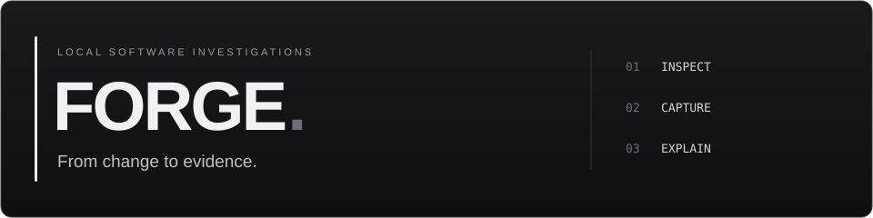

<p></p>

<p>
  <a href="https://github.com/illusionoftalha/forge/releases"></a>&nbsp;
  <a href="docs/guide.md"></a>&nbsp;
  <a href="https://github.com/illusionoftalha/forge/actions/workflows/checks.yml"></a>
</p>

Inspect a Git change, analyze a JVM thread dump, and keep the evidence together. **Forge is a local desktop workbench for understanding software failures.**

### One investigation, start to finish

**Inspect** a patch, track renamed files, or jump from a search result to its source line.<br>
**Capture** thread analysis and source snapshots with timestamps and content hashes.  
**Explain** the finding in a persistent notebook, then export a standalone HTML report.

No accounts, cloud service, or model API. Repository inspection does not execute project code.

### Run

Requires **Java 17+**, **Python 3.10+**, and **Git**. Extract the release ZIP and keep its files together.

```sh
java -jar build/forge.jar
```

Run from the extracted `forge` directory. To build from source, use `./build.ps1` on Windows or `sh build.sh` on Linux/macOS. Both run the tests before packaging.

### Try a real workflow

```sh
python fixtures/create_demo.py demo
java -jar build/forge.jar demo/workspace
```

The synthetic repository contains a lock-order regression. Inspect its commit, import `fixtures/incident.txt`, capture the monitor-cycle analysis, and export your findings.

### Scope

The repository index refreshes locally and reuses unchanged files. Search covers up to 32 MiB of text. Symbol navigation and log timelines are on the roadmap.

<p>
  <a href="docs/architecture.md"></a>&nbsp;
  <a href="docs/roadmap.md"></a>
</p>

<sub>Java · Python · SQLite · MIT license</sub>
