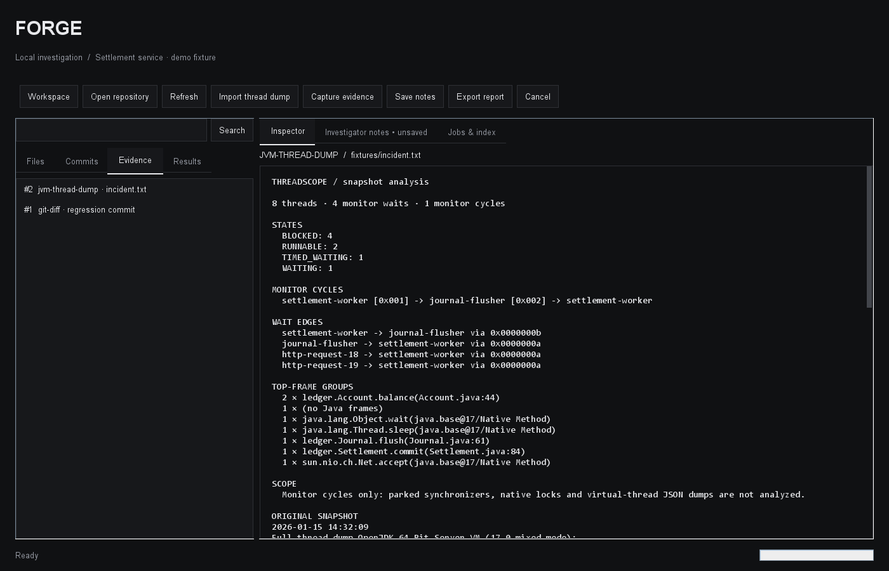

# User guide

**Follow a regression from the commit to the evidence.**

[](https://github.com/illusionoftalha/forge/actions/workflows/checks.yml)

Forge is a local desktop workbench for investigating software failures. Open a Git repository, inspect a change, analyze a JVM thread dump, capture the evidence, and export a report that another developer can read without installing Forge.



Version 0.2 adds a persistent repository index to the investigation workflow.

## What works

| Surface | Capabilities |
| --- | --- |
| Repository | Tracked and non-ignored untracked files; text previews; literal search |
| Git | Up to 80 recent commits across refs, patch inspection, tracked working-tree status |
| Thread dumps | Traditional HotSpot dumps, monitor wait edges, cycle analysis, top-frame groups |
| Evidence | Captured text, source reference, UTC timestamp, SHA-256 digest |
| Notebook | SQLite-backed notes and evidence that survive closing the app |
| Export | Self-contained HTML with escaped evidence, notes, and provenance |
| Jobs | Background analysis, bounded worker output, timeouts, cancellation |

The inspected repository is read-only. Forge does not run its programs, build scripts, Git hooks, diff drivers, or text converters. Python workers use only the standard library. No network service, account, model API, or telemetry is involved in application use.

## Requirements

- Java **17+**; a JDK is needed to build.
- Python **3.10+**, available as `python` on PATH.
- Git on PATH.
- A desktop session for the Swing interface.

Set `FORGE_PYTHON` to an absolute Python executable if needed. The release ZIP includes the JAR **and** its Python worker; keep the bundle together. The JAR is not a standalone distribution.

## Build and launch

```powershell
# Windows, from the repository root
./build.ps1
./run.ps1
```

```sh
# Linux / macOS, from the repository root
sh build.sh
sh run.sh
```

Build scripts run the Python tests and Java integration checks before packaging `build/forge.jar`. The default workspace is `forge-workspace` beside the application, not inside the repository you inspect. Use **Workspace** to select another folder, or pass its absolute path to the launch script.

## A complete investigation in five minutes

Create a fresh demo directory:

```sh
python fixtures/create_demo.py demo
java -jar build/forge.jar demo/workspace
```

The generator creates a **synthetic** repository with two commits. The second reverses monitor acquisition order in `Journal.flush`. It also creates a workspace with the regression diff already captured and a short starting hypothesis.

1. Select **Commits**, then the lock-order regression. Inspect the actual patch.
2. Select **Import thread dump** and open `fixtures/incident.txt`.
3. Inspect the two-thread monitor cycle: `settlement-worker` waits on `journal-flusher`, which waits on `settlement-worker`.
4. Select **Capture evidence** to save the report and original thread snapshot.
5. Open **Investigator notes**, record the finding, and select **Save notes**.
6. Select **Export report** and choose a new HTML filename. Open it in a browser.
7. Close and reopen the same workspace. The notes and captured evidence remain available even if the inspected repository later disappears.

The dump is a fixture, not a measurement of the demo source running. Its purpose is to make the complete investigation reproducible.

## Evidence, not guesses

Captured content is a snapshot. Editing a source file later does not rewrite an existing capture. The digest covers the captured UTF-8 text, including replacement characters if a source file contained invalid UTF-8; it is not necessarily a hash of the original file bytes. A digest identifies content, not its authenticity.

Thread analysis follows intrinsic monitor ownership. It excludes native locks, AQS synchronizers, virtual-thread JSON dumps, and distributed waits. No reported cycle does **not** establish that a process is healthy. The underlying analyzer is adapted from [Threadscope](https://github.com/illusionoftalha/threadscope).

Exports can contain source code, local paths, commit metadata, and stack traces. Choose what to capture before sharing an investigation.

## Practical limits

Open, refresh, and search synchronize the workspace index. Choose a match in **Results** to open its file with the line highlighted. If the content has changed since the search, Forge opens the current file and asks you to search again.

**Jobs & index → View changes** shows the last nonempty difference between completed index refreshes. On the first refresh, eligible files appear as additions. A rename requires one removed path and one added path with identical decoded content; ambiguous moves appear as additions and removals. This view compares working-tree observations, not historical Git commits. **Rebuild index** forces every eligible file to be read, including files whose timestamps were restored manually.

The workspace now stores indexed source text, including eligible untracked files. Keep the workspace outside the inspected repository. Share a selected HTML export instead of the entire workspace when you only intend to share captured evidence. Opening a 0.1 workspace upgrades it to schema 2; make a copy first if you need to reopen it with an older release.

- Preview and imported dump limit: **2 MiB** each.
- File listing: **20,000** entries; Git ignore rules and common dependency/build directories are skipped.
- Index: **32 MiB** of UTF-8 text, **20,000** listed paths and a **22-second** refresh budget. When the index is too large, browsing and existing evidence remain available. Search reports the limit instead of returning a partial index. Binary, unreadable, missing and oversized files are skipped.
- Search: **300** line matches; the result summary reports truncation and skipped files. Search scans cached text after checking file metadata.
- Git output: **4 MiB**, with a **15-second** deadline.
- Desktop worker deadline: **30 seconds**. Cancellation terminates an active worker and its child processes; already-committed SQLite writes remain saved.
- One desktop instance per workspace is the supported editing model.
- Repository access is ordinary filesystem access, not a security sandbox. Avoid repositories being mutated adversarially while reading them.
- Notes are explicitly saved; closing or changing workspaces warns about unsaved edits. Export saves the current note snapshot first and refuses to overwrite an existing report.

## Architecture

```text
Swing desktop ── protocol v1 / JSON ── Python worker
     │                                  ├── read-only Git commands
     │                                  ├── bounded source inspection
     │                                  └── SQLite workspace + HTML export
     └── JVM thread-dump analyzer
```

The implementation uses Java 17 and Swing to reuse a tested analyzer and avoid framework downloads. JavaFX, Java 21, and native installers from the original design remain possible later decisions rather than hidden prerequisites.

See [architecture](architecture.md), [protocol](protocol.md), and [roadmap](roadmap.md).

## Verification

```sh
python -m unittest discover -s tests -v
# Java integration checks run automatically in the build scripts.
java -jar build/forge.jar --render docs/workbench.png
```

The Python suite covers an actual Git-to-report investigation, workspace restore, ignored files, malformed protocol input, commit-argument rejection, path traversal, binary and oversized files, HTML escaping, overwrite refusal, empty repositories, and source preservation.

Java checks exercise JSON handling, the real Python worker, persistent SQLite state, monitor-cycle analysis, and export. The preview command renders the actual Swing component tree with synthetic incident data. It is a layout check, not a substitute for manual interaction testing. CI builds on Windows and Linux; Linux also renders under Xvfb.

MIT licensed. See [third-party notices](../THIRD_PARTY.md).
